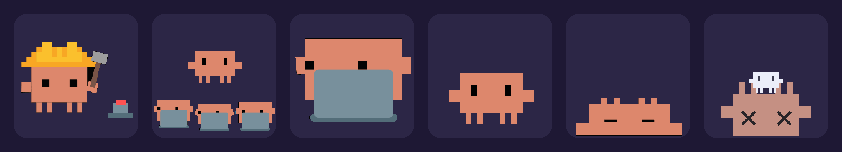

# Clawd Presence

Show your Claude Code sessions in your Discord activity: an animated Clawd (the Claude Code mascot) that follows what Claude is doing, a short summary of what you are working on, and what every open session is up to.



On your Discord profile it looks like this:

```
Playing Сlaude Code
Dark mode for the website                              ← summary of your last 2 messages
3 sessions: Writing code, Thinking, Idle · 38.7M tokens   ← what each session is doing
🎮 3:12:05                                             ← since your first session started
```

Hover the image to see the summary of every session. The token count adds up everything Claude processed in your open sessions and their helpers (input, output and cache), read from Claude Code's own session history.

Every open Claude Code window is shown, even one opened before the plugin was installed: the plugin reads Claude Code's own list of running sessions.

| Clawd | When |
| --- | --- |
| Hard hat | Claude is writing code or running commands |
| Conductor with mini Clawds | Claude is only waiting for its helpers (subagents) |
| At the laptop | Claude is thinking, reading code, searching the web |
| Waving | Claude is waiting for your answer or permission, or it is done |
| Sleeping | Session open but idle for 15 minutes |
| Knocked out, with a ghost | You hit your usage limit: shows "Out of tokens" and a countdown to the reset |

When your usage limit resets, the timer and the token counter start again from zero.

Works on **macOS, Windows and Linux**.

## Requirements

- **Claude Code**, up to date.
- **The Discord desktop app** running on the same computer (not the browser version).
- **Python 3.8 or newer**:
  - macOS: often already there. Otherwise `brew install python`, or the installer from [python.org](https://www.python.org/downloads/).
  - Windows: installer from [python.org](https://www.python.org/downloads/), with **"Add python.exe to PATH"** ticked. You also need [Git for Windows](https://git-scm.com/download/win) (Claude Code already uses it to run hooks).
  - Linux: already installed almost everywhere.
- In Discord: **Settings → Activity Privacy → "Share my activity"** turned on.

## Install

In Claude Code, type:

```
/plugin marketplace add Louiscvo/clawd-presence
/plugin install clawd-presence@clawd-presence
```

Then restart Claude Code (or type `/reload-plugins` in each open session). Your activity shows up on Discord as soon as Claude does something.

Nothing else to set up: no program to add to startup. The small program that talks to Discord starts by itself with Claude Code and stops 10 minutes after your last session closes.

## Settings

Type `/config` in Claude Code, **Clawd Presence** section:

| Setting | Default | Effect |
| --- | --- | --- |
| Work summary | on | Shows a summary of your last 2 messages in each session |
| Language | `auto` | `fr`, `en`, or `auto` (your computer's language) |
| Discord application ID | the "Сlaude Code" app | Changes the name shown after "Playing" (see below) |

> ⚠️ **The summary is visible to everyone who can see your Discord profile** (friends, members of your servers). If you work on something secret, turn it off. Summaries are made by Claude Haiku and use a tiny bit of your plan for each new message. Your messages are never sent to Discord, only the short title.

## How it works

1. A Claude Code **hook** records the state of each session (what Claude is doing, your last 2 messages) in `~/.claude/plugins/data/clawd-presence-clawd-presence/`.
2. A **small program** (`scripts/presence.py`) reads those files every 4 seconds and sends the activity to the Discord app, locally on your computer (no server, no account).
3. With several sessions, the most "urgent" one leads: a session waiting for you comes before one that is working.

## Troubleshooting

**Nothing shows up**
- Is the Discord desktop app open, with "Share my activity" on?
- Did you restart Claude Code (or run `/reload-plugins`) after installing? A session only appears once Claude does something in it.
- Check the log: `~/.claude/plugins/data/clawd-presence-clawd-presence/presence.log`.
- To see what would be sent to Discord:
  ```
  python3 ~/.claude/plugins/cache/clawd-presence/clawd-presence/*/scripts/presence.py ~/.claude/plugins/data/clawd-presence-clawd-presence --print
  ```

**A game or another app shows first**
Discord picks which activity to show first. Apps that publish their own activity (Modrinth, some launchers…) usually have a setting to turn it off.

**I want another name than "Сlaude Code"**
Create an application on the [Discord Developer Portal](https://discord.com/developers/applications) with the name you want, copy its "Application ID" and paste it into the *Discord application ID* setting. Discord often refuses names containing "Claude": the default one uses a Cyrillic "С".

## Uninstall

```
/plugin uninstall clawd-presence@clawd-presence
```

## Credits

- Clawd is the Claude Code mascot, by Anthropic. This project is not affiliated with Anthropic or Discord.
- The Clawd animations come from the [claude-rpc](https://github.com/rar-file/claude-rpc) project, cut out and cropped here. The default "Сlaude Code" Discord application also comes from claude-rpc.
- Code under the MIT license.

---

## Français

Affiche tes sessions Claude Code dans ton activité Discord : Clawd animé selon ce que fait Claude, un résumé de ce sur quoi tu travailles, ce que fait chaque fenêtre ouverte, les tokens utilisés et un chrono depuis le lancement de ta première session. Quand tu n'as plus de tokens, Clawd tombe K.O. avec un compte à rebours jusqu'à la reprise. Marche sur macOS, Windows et Linux.

**Il faut** : l'application Discord ouverte sur l'ordinateur (avec « Partager mon activité » activé dans Paramètres → Confidentialité de l'activité), et Python 3.8 ou plus récent (sur Windows : installateur de python.org avec « Add python.exe to PATH », plus Git for Windows).

**Installation**, dans Claude Code :

```
/plugin marketplace add Louiscvo/clawd-presence
/plugin install clawd-presence@clawd-presence
```

Redémarre Claude Code (ou tape `/reload-plugins` dans chaque session ouverte), et ton activité apparaît dès que Claude fait quelque chose.

**Réglages** dans `/config`, partie Clawd Presence : résumé activé ou non, langue (`fr`, `en` ou `auto`), identifiant d'application Discord. ⚠️ Le résumé est visible par tous ceux qui voient ton profil : désactive-le si tu travailles sur quelque chose de secret.

**Rien ne s'affiche ?** Vérifie que Discord est ouvert, que tu as relancé Claude Code après l'installation, et regarde le journal `~/.claude/plugins/data/clawd-presence-clawd-presence/presence.log`.
